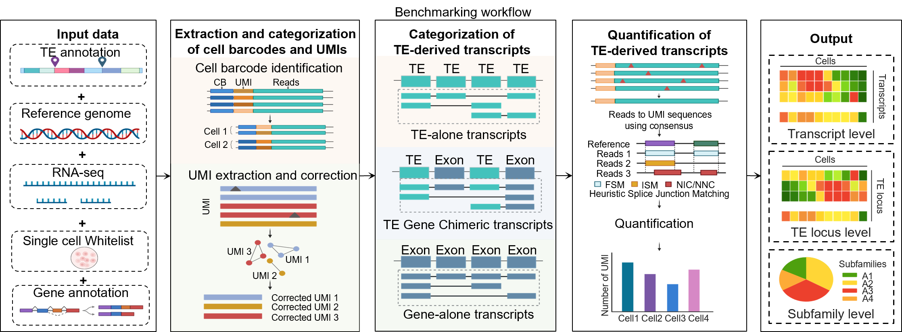
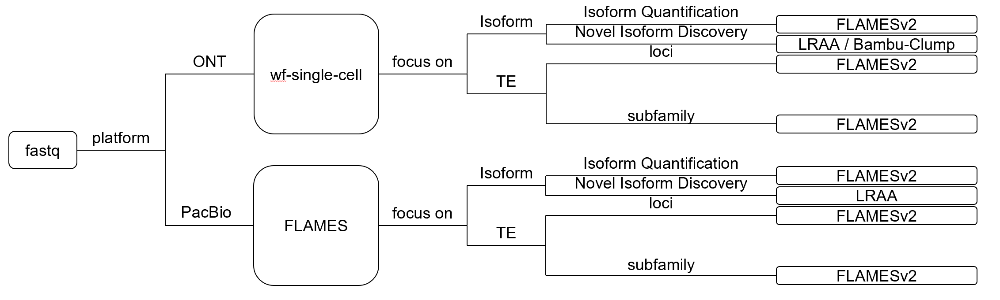

# scLongTEQuant

**Benchmarking, workflow recommendations, and reproducible scripts for transposable element (TE)-derived and TE-associated transcript quantification from single-cell long-read RNA-seq**

## Overview

`scLongTEQuant` is a resource for benchmarking and recommending analysis strategies for transposable element (TE)-derived and TE-associated transcripts in single-cell long-read RNA-seq data, including PacBio and Oxford Nanopore Technologies (ONT) data. The project evaluates multiple tools that generate quantification matrices from long-read RNA-seq data and uses companion in-house scripts to classify the resulting matrices into distinct transcript categories:

- **Gene-alone** transcripts;
- **TE-alone** transcripts;
- **TE–Gene chimeric** transcripts.

The classified results are further aggregated and quantified at both the **TE locus level** and the **TE subfamily level**. Based on the benchmarking results, `scLongTEQuant` provides a step-wise recommendation scheme for tool selection and analysis strategy, together with reproducible scripts and configuration files.

## Project Positioning

`scLongTEQuant` is positioned as a **benchmarking resource, a step-wise workflow recommendation guide, and a reproducible script collection**, rather than a single new quantification algorithm or standalone software tool. The project does not bind itself to any single quantification tool; Instead, it recommends suitable tool combinations for different analysis steps according to the analysis objective and data characteristics, and provides guidance on their use.

## Key Features

- Benchmarking of multiple tools that generate quantification matrices from single-cell long-read RNA-seq data;
- Unified classification of tool-derived matrices into Gene-alone, TE-alone, and TE–Gene chimeric transcripts;
- Quantification at the TE locus level;
- Quantification at the TE subfamily level;
- Comparative evaluation of TE detection, transcript classification, quantification consistency, and aggregation results;
- Step-wise recommendations for tool selection across the analysis workflow;
- Reproducible scripts, configuration files, and summary tables for benchmarking and downstream analysis.

## Recommended Workflow Overview




## Installation of Recommended Tools

The commands below target a Linux environment. Create a working directory and substitute `path/to/` with the corresponding local path. Versions are those used in the benchmark.

### Prerequisites

Install a Conda distribution such as [Miniforge](https://github.com/conda-forge/miniforge) before creating the environments below. Four additional components are required alongside FLAMESv2, LRAA, wf-single-cell, and Bambu-pipe.

#### Java and Nextflow

[wf-single-cell](https://github.com/epi2me-labs/wf-single-cell) v3.3.4 requires Nextflow >= 23.04.2. [Bambu-pipe](https://github.com/GoekeLab/bambu-pipe) v0.9.1 requires Nextflow >= 26.04.0 and therefore determines the version installed here. Nextflow requires Bash >= 3.2 and Java 17–26 ([installation guide](https://docs.seqera.io/nextflow/install)).

```bash
conda install -y -c conda-forge openjdk=17
curl -s https://get.nextflow.io | bash
chmod +x nextflow
mkdir -p "$HOME/.local/bin"
mv nextflow "$HOME/.local/bin/"
export PATH="$HOME/.local/bin:$PATH"
nextflow info
```

#### Singularity

FLAMESv2 is distributed as a Singularity image, and wf-single-cell and Bambu-pipe run under the Singularity profile. On an HPC system, load the site module that provides the `singularity` command:

```bash
module load singularity
```

On a standalone Linux system, install [Apptainer](https://apptainer.org/docs/admin/main/installation.html), which provides the same command-line interface. The image used for FLAMESv2 is retrieved with:

```bash
singularity pull path/to/flames.sif docker://ghcr.io/mritchielab/flames:20af1ce
```

This image corresponds to the container documented for [FLAMES](https://github.com/mritchielab/FLAMES) at commit `20af1ce`.

#### fastplong 0.4.1

[fastplong](https://github.com/OpenGene/fastplong) v0.4.1 performs quality control for both PacBio and ONT reads. The Bioconda recipe is the installation route given in the v0.4.1 documentation.

```bash
conda create -n fastplong -y -c bioconda -c conda-forge fastplong=0.4.1
conda activate fastplong
fastplong --help
```

#### miniTEQuant

[miniTEQuant](https://github.com/calm109/miniTEQuant) builds the TE annotation and calculates TE-locus, TE-subfamily, and transcript-class results.

```bash
git clone https://github.com/calm109/miniTEQuant.git path/to/miniTEQuant
cd path/to/miniTEQuant
conda env create -f environment.yml
conda activate miniTEQuant
```

The upstream installation additionally provides minimap2, flexiplex, and nailpolish for analyses in which miniTEQuant itself demultiplexes, aligns, and quantifies reads. In the workflow recommended here those operations are performed by wf-single-cell and FLAMESv2, so the environment created above is sufficient for `create_simple_TE_gtf.py` and `cal_TE`.

### FLAMESv2

Pull the Singularity image shown in [Prerequisites](#singularity). The image already contains the FLAMES R package, flexiplex, minimap2, samtools, and Oarfish used by `SingleCellPipeline`. Enter the image to confirm that the package loads:

```bash
singularity exec -e path/to/flames.sif Rscript -e 'library(FLAMES); packageVersion("FLAMES")'
```

Documentation: [mritchielab/FLAMES](https://github.com/mritchielab/FLAMES) and the [single-cell pipeline reference](https://mritchielab.github.io/FLAMES/reference/SingleCellPipeline.html).

### LRAA 0.15.0

[LRAA](https://github.com/MethodsDev/LongReadAlignmentAssembler) v0.15.0 is used for reference-guided novel-isoform discovery. The tagged release contains the `LRAA` executable. Its Python and alignment dependencies are installed in a dedicated environment.

```bash
git clone --branch LRAA_v0.15.0 --recursive \
    https://github.com/MethodsDev/LongReadAlignmentAssembler.git \
    path/to/LongReadAlignmentAssembler
cd path/to/LongReadAlignmentAssembler
chmod +x LRAA
export PATH="path/to/LongReadAlignmentAssembler:$PATH"

conda create -n lraa -y python=3.10
conda activate lraa
conda install -y -c bioconda -c conda-forge samtools pysam gffcompare
conda install -y -c conda-forge python-igraph leidenalg tqdm
pip install pandas scipy numpy psutil lmdb
```

Further usage is described in the [LRAA wiki](https://github.com/MethodsDev/LongReadAlignmentAssembler/wiki). For single-cell BAMs produced by this workflow, cell barcodes and UMIs are stored in the `CB` and `UB` tags.

### wf-single-cell 3.3.4

wf-single-cell is executed remotely by Nextflow; a separate compilation step is not required. Retrieve release v3.3.4 and inspect its parameters:

```bash
nextflow pull epi2me-labs/wf-single-cell -r v3.3.4
nextflow run epi2me-labs/wf-single-cell -r v3.3.4 --help
```

The workflow downloads its own containers when `-profile singularity` is set. The reference directory must follow the 10x layout documented by [epi2me-labs/wf-single-cell](https://github.com/epi2me-labs/wf-single-cell): `path/to/ref_genome_dir/fasta/genome.fa` and `path/to/ref_genome_dir/genes/genes.gtf`. These two files are `path/to/genome.fa` and `path/to/genes.gtf`.

### Bambu-pipe 0.9.1

Clone the v0.9.1 release of [Bambu-pipe](https://github.com/GoekeLab/bambu-pipe). Software dependencies are supplied by the Singularity images that the pipeline requests.

```bash
git clone --branch v0.9.1 --depth 1 \
    https://github.com/GoekeLab/bambu-pipe.git \
    path/to/bambu-pipe
cd path/to/bambu-pipe
nextflow run main.nf --help
```

Run the pipeline with `-profile singularity`. On a local machine add `,local`; on Slurm add `,hpc`, as described in the repository README.

## Input Files

Paths below are generic. A file that reappears in a later command is written with the same name.

| File | Role |
| --- | --- |
| `path/to/reads.fastq.gz` | Platform-specific long-read FASTQ. Plain `.fastq`, `.fq`, and gzip-compressed files are accepted. |
| `path/to/reads_filtered.fastq.gz` | Reads retained by fastplong, together with `path/to/reads_filtered_report.html` and `path/to/reads_filtered_report.json`. |
| `path/to/genome.fa` | Reference genome FASTA. |
| `path/to/genes.gtf` | Reference gene annotation in GTF format. |
| `path/to/ref_genome_dir` | 10x-style reference directory for wf-single-cell, containing `fasta/genome.fa` and `genes/genes.gtf`. |
| `path/to/barcodes.txt` | Cell-barcode whitelist, one barcode per line. Decompress a gzipped whitelist before use. |
| `path/to/tagged.bam` | Coordinate-sorted BAM that already carries cell-barcode and UMI tags. This is either the starting file, when both tags are already present, or the alignment written by wf-single-cell (`<sample>/<sample>.tagged.bam`). |
| `path/to/align2genome.bam` | Genome alignment written by FLAMESv2 for PacBio reads, with cell barcodes in `CB` and UMIs in `UB`. |
| `path/to/samplesheet.csv` | Bambu-pipe sample sheet. The header is `sample,path,chemistry,technology`, and `path` points to `path/to/reads_filtered.fastq.gz`. |
| `path/to/extended_annotation.gtf` | Annotation GTF written by LRAA or by Bambu-pipe when novel isoforms are discovered. |
| `path/to/flames.sif` | FLAMESv2 Singularity image. |
| `path/to/repeatmasker.out` | RepeatMasker annotation used to construct the TE GTF. |
| `path/to/TE_annotation.gtf` | TE annotation GTF produced by miniTEQuant from `path/to/repeatmasker.out`. |
| `path/to/filtered_feature_bc_matrix` | Transcript-by-cell count matrix in 10x Market Exchange format (`barcodes.tsv`, `features.tsv`, `matrix.mtx`), derived from the FLAMESv2 Oarfish output. |

The annotation supplied to FLAMESv2 is also the annotation supplied to miniTEQuant. Without novel-isoform discovery that file is `path/to/genes.gtf`. With novel-isoform discovery it is `path/to/extended_annotation.gtf`.

## Usage of Recommended Tools

The workflow is organized into five major steps. Each step can be run independently or integrated into a workflow management system such as Snakemake or Nextflow. A file that is reused in a later step keeps the same path throughout this document.

Set `THREADS` to the number of available cores. Activate the environment named in each command before running it.

### Data Quality Control and Filtering

Quality control uses fastplong 0.4.1 on `path/to/reads.fastq.gz`. Both platforms use the thresholds applied in the benchmark: discard reads with mean Phred quality below 20 (`-m 20`) or length below 100 bp (`-l 100`), and disable adapter trimming (`-A`). HTML and JSON reports are written beside the filtered FASTQ.

#### PacBio

```bash
conda activate fastplong
fastplong \
    -i path/to/reads.fastq.gz \
    -o path/to/reads_filtered.fastq.gz \
    -h path/to/reads_filtered_report.html \
    -j path/to/reads_filtered_report.json \
    -m 20 \
    -l 100 \
    -w "$THREADS" \
    -A
```

#### ONT

```bash
conda activate fastplong
fastplong \
    -i path/to/reads.fastq.gz \
    -o path/to/reads_filtered.fastq.gz \
    -h path/to/reads_filtered_report.html \
    -j path/to/reads_filtered_report.json \
    -m 20 \
    -l 100 \
    -w "$THREADS" \
    -A
```

`path/to/reads_filtered.fastq.gz` is the read file used by wf-single-cell, FLAMESv2, and Bambu-pipe.

### Processing Cell Barcodes and UMIs

This step produces a coordinate-sorted BAM in which the corrected cell barcode is stored in the `CB` tag and the corrected UMI in the `UB` tag.

If the input is already such a BAM, skip this step and use that file as `path/to/tagged.bam`.

#### ONT FASTQ

Run wf-single-cell v3.3.4 on `path/to/reads_filtered.fastq.gz`. `--kit` follows the 10x library; `3prime:v3` is the value for Chromium 3' v3 and Next GEM 3' v3.1. `--expected_cells` is the expected number of cells. The reference directory is `path/to/ref_genome_dir`.

```bash
nextflow run epi2me-labs/wf-single-cell -r v3.3.4 \
    -profile singularity \
    --fastq path/to/reads_filtered.fastq.gz \
    --expected_cells EXPECTED_CELLS \
    --kit '3prime:v3' \
    --ref_genome_dir path/to/ref_genome_dir \
    --out_dir path/to/wf_output \
    --threads "$THREADS" \
    -resume
```

The alignment consumed by later steps is the per-sample file written under `path/to/wf_output`. Copy or link it to `path/to/tagged.bam`, and confirm that `path/to/tagged.bam.bai` exists:

```bash
conda activate lraa
samtools index path/to/tagged.bam
```

#### PacBio

FLAMESv2 assigns barcodes and UMIs with flexiplex and aligns the retained reads to `path/to/genome.fa`. The whitelist is `path/to/barcodes.txt`. Isoform discovery inside FLAMESv2 is turned off; novel isoforms, when required, are discovered in the next step. Quantification uses Oarfish.

Bind the parent directory that contains the FASTQ, reference, whitelist, and image, then run:

```bash
export THREADS
singularity exec -e \
    --bind path/to:path/to \
    path/to/flames.sif \
    Rscript path/to/run_flames.R
```

`path/to/run_flames.R`:

```r
options(bspm.sudo = TRUE)
basilisk::setBasiliskFork(FALSE)
suppressPackageStartupMessages(library(FLAMES))

outdir   <- "path/to/flames_output"
fastq    <- "path/to/reads_filtered.fastq.gz"
annot    <- "path/to/genes.gtf"
genome   <- "path/to/genome.fa"
barcodes <- "path/to/barcodes.txt"
threads  <- as.integer(Sys.getenv("THREADS", "8"))

dir.create(outdir, recursive = TRUE, showWarnings = FALSE)
cfg <- create_config(
  outdir,
  pipeline_parameters.demultiplexer = "flexiplex",
  do_isoform_identification = FALSE,
  bambu_isoform_identification = FALSE,
  oarfish_quantification = TRUE,
  threads = threads
)

pipeline <- SingleCellPipeline(
  config_file   = cfg,
  outdir        = outdir,
  fastq         = c(fastq),
  annotation    = annot,
  genome_fa     = genome,
  barcodes_file = barcodes
)
pipeline <- run_FLAMES(pipeline)
saveRDS(pipeline, file.path(outdir, "pipeline.rds"))
```

The tagged genome alignment from this run is `path/to/flames_output/align2genome.bam`. Use it downstream as `path/to/align2genome.bam`. When novel-isoform discovery is not required, this same run is the quantification step: its annotation is `path/to/genes.gtf`, and the Oarfish matrix in `path/to/flames_output` is the matrix converted in [Transcript Identification and Quantification](#transcript-identification-and-quantification).

### Transcript Identification and Quantification

First decide whether transcript models beyond `path/to/genes.gtf` are required.

#### Novel-isoform discovery

Discover isoforms with either LRAA 0.15.0 or Bambu-pipe 0.9.1. Both results are subsequently referred to as `path/to/extended_annotation.gtf`, and that file replaces `path/to/genes.gtf` as the annotation for FLAMESv2 quantification.

**LRAA.** Sort the BAM by coordinate when its header does not already report `SO:coordinate`, then index it. Mitochondrial contigs listed in `--oversimplify` follow the chromosome names in `path/to/genome.fa`; `chrM` matches the GRCh38 contig name. LRAA writes `path/to/extended_annotation.gtf`.

For ONT, and for a BAM that already carries `CB` and `UB`, the input alignment is `path/to/tagged.bam`:

```bash
conda activate lraa
samtools index path/to/tagged.bam

LRAA \
    --genome path/to/genome.fa \
    --bam path/to/tagged.bam \
    --gtf path/to/genes.gtf \
    --output_prefix path/to/extended_annotation \
    --cell_barcode_tag CB \
    --read_umi_tag UB \
    --num_parallel_contigs 4 \
    --num_threads_per_worker "$THREADS" \
    --oversimplify chrM
```

For PacBio HiFi, the input alignment is `path/to/align2genome.bam` and `--HiFi` is set:

```bash
conda activate lraa
samtools index path/to/align2genome.bam

LRAA \
    --genome path/to/genome.fa \
    --bam path/to/align2genome.bam \
    --gtf path/to/genes.gtf \
    --output_prefix path/to/extended_annotation \
    --cell_barcode_tag CB \
    --read_umi_tag UB \
    --num_parallel_contigs 4 \
    --num_threads_per_worker "$THREADS" \
    --oversimplify chrM \
    --HiFi
```

**Bambu-pipe.** The sample sheet `path/to/samplesheet.csv` points at the filtered FASTQ. Set `technology` to `PacBio` or `ONT`, and set `chemistry` to the library chemistry (`10x3v3` for 10x Chromium 3' v3). Quality filtering inside the pipeline is disabled because `path/to/reads_filtered.fastq.gz` has already passed fastplong. `--quantification_mode no_quant` retains transcript discovery and writes the extended annotation; cell-level counts are produced by FLAMESv2.

```csv
sample,path,chemistry,technology
sample,path/to/reads_filtered.fastq.gz,10x3v3,ONT
```

```bash
cd path/to/bambu-pipe
nextflow run main.nf \
    --input path/to/samplesheet.csv \
    --genome path/to/genome.fa \
    --annotation path/to/genes.gtf \
    --output_dir path/to/bambu_output \
    --chemistry 10x3v3 \
    --technology ONT \
    --qscore_filtering false \
    --quantification_mode no_quant \
    -profile singularity,local
```

Copy `path/to/bambu_output/extended_annotations.gtf` to `path/to/extended_annotation.gtf`.

#### Quantification with FLAMESv2

FLAMESv2 quantifies `path/to/reads_filtered.fastq.gz` against `path/to/barcodes.txt` and `path/to/genome.fa`. A pre-existing tagged BAM is the input to LRAA; the quantification command still reads the filtered FASTQ. Use the R script in the PacBio barcode section and set `annot` as follows.

- When novel-isoform discovery was not performed, `annot` is `path/to/genes.gtf`. On PacBio, the FLAMESv2 run that assigned barcodes has already completed this quantification.
- When novel-isoform discovery was performed, `annot` is `path/to/extended_annotation.gtf`. Run FLAMESv2 again with that annotation. The read file remains `path/to/reads_filtered.fastq.gz`, the whitelist remains `path/to/barcodes.txt`, and the genome remains `path/to/genome.fa`.

Oarfish writes three files into `path/to/flames_output`: `<prefix>.count.mtx`, `<prefix>.features.txt`, and `<prefix>.barcodes.txt`. The count matrix is oriented with cells as rows. Convert it to the 10x Market Exchange layout expected by miniTEQuant, in which `matrix.mtx` has transcripts as rows and cells as columns:

```bash
conda activate miniTEQuant
python - <<'PY'
from pathlib import Path
from scipy import io, sparse

src = Path("path/to/flames_output")
dst = Path("path/to/filtered_feature_bc_matrix")
dst.mkdir(parents=True, exist_ok=True)

prefix = next(src.glob("*.count.mtx")).name[: -len(".count.mtx")]
barcodes = (src / f"{prefix}.barcodes.txt").read_text().splitlines()
features = [
    line.split("\t", 1)[0]
    for line in (src / f"{prefix}.features.txt").read_text().splitlines()
    if line
]
matrix = io.mmread(src / f"{prefix}.count.mtx").tocsr()
if matrix.shape == (len(barcodes), len(features)):
    matrix = matrix.T.tocsr()
if matrix.shape != (len(features), len(barcodes)):
    raise SystemExit(f"Unexpected matrix shape {matrix.shape}")

(dst / "barcodes.tsv").write_text("\n".join(barcodes) + "\n")
(dst / "features.tsv").write_text("\n".join(features) + "\n")
io.mmwrite(dst / "matrix.mtx", sparse.coo_matrix(matrix))
PY
```

`path/to/filtered_feature_bc_matrix` is the quantification matrix used for TE quantification and transcript classification. Transcript identifiers in `features.tsv` are the identifiers assigned under the annotation supplied to FLAMESv2.

### TE Locus and Subfamily-Level Quantification

Build the TE annotation once from the RepeatMasker output, then quantify TE loci and subfamilies with `cal_TE`. The transcript GTF must be the annotation used for the count matrix: `path/to/genes.gtf`, or `path/to/extended_annotation.gtf` after novel-isoform discovery.

```bash
conda activate miniTEQuant
cd path/to/miniTEQuant

python isoform_quantification/TE_analyse/create_simple_TE_gtf.py \
    -i path/to/repeatmasker.out \
    -o path/to/TE_annotation.gtf

python isoform_quantification/main.py cal_TE \
    -gtf path/to/genes.gtf \
    -te_gtf path/to/TE_annotation.gtf \
    --custom_sc_quant path/to/filtered_feature_bc_matrix \
    -t "$THREADS" \
    -o path/to/te_quant
```

When the count matrix was generated with `path/to/extended_annotation.gtf`, pass that same file to `-gtf` in place of `path/to/genes.gtf`.

Per-cell results are written to `path/to/te_quant/Custom_SC_TE_output`:

| File | Content |
| --- | --- |
| `cell_transcript_classification_counts.tsv` | Transcript records used for classification. Column 1 is the transcript identifier from the GTF, and column 11 is its class. |
| `cell_te_class_counts.tsv` | Counts aggregated to TE class. |
| `cell_te_family_counts.tsv` | Counts aggregated to TE family. |
| `cell_te_subfamily_counts_barcodes.tsv` | Cell barcodes for the subfamily matrix. |
| `cell_te_subfamily_counts_features.tsv` | TE subfamily identifiers. |
| `cell_te_subfamily_counts_matrix.mtx` | Cell-by-subfamily count matrix. |
| `cell_te_loci_counts_barcodes.tsv` | Cell barcodes for the locus matrix. |
| `cell_te_loci_counts_features.tsv` | TE locus identifiers. |
| `cell_te_loci_counts_matrix.mtx` | Cell-by-locus count matrix. |

The subfamily and locus matrices follow the Market Exchange convention, with features as rows and cells as columns. They are read by `Seurat::ReadMtx()` or `scanpy.read_mtx()`.

### Transcript Classification

`path/to/te_quant/Custom_SC_TE_output/cell_transcript_classification_counts.tsv` classifies transcripts that are present in the GTF passed to `cal_TE`. The first column is the transcript identifier and the eleventh column is the class (`Gene-alone`, `TE-alone`, or `TE-Gene`). These identifiers are annotation identifiers. They are matched to the transcript identifiers in `path/to/filtered_feature_bc_matrix/features.tsv` before counts are summed within each class. An exact match is accepted first. A remaining identifier is matched after removal of a trailing Ensembl version suffix, so that `ENST00000448958` and `ENST00000448958.2` refer to the same transcript. Counts of matched transcripts are then summed, producing one quantification matrix per transcript class.

```bash
conda activate miniTEQuant
python - <<'PY'
import gzip
import re
from pathlib import Path

import numpy as np
import pandas as pd
from scipy import io

quant_dir = Path("path/to/filtered_feature_bc_matrix")
class_file = Path(
    "path/to/te_quant/Custom_SC_TE_output/cell_transcript_classification_counts.tsv"
)
out_file = Path("path/to/transcript_class_counts.tsv")
map_file = Path("path/to/transcript_class_map.tsv")
unmatched_file = Path("path/to/unmatched_transcripts.txt")


def open_text(path):
    return gzip.open(path, "rt") if str(path).endswith(".gz") else open(path)


def locate(stem):
    for name in (stem, stem + ".gz"):
        candidate = quant_dir / name
        if candidate.exists():
            return candidate
    raise FileNotFoundError(quant_dir / stem)


def strip_version(identifier):
    return re.sub(r"\.\d+$", "", identifier)


barcodes = [line.strip() for line in open_text(locate("barcodes.tsv")) if line.strip()]
features = []
with open_text(locate("features.tsv")) as handle:
    for line in handle:
        fields = line.rstrip("\n").split("\t")
        if fields and fields[0]:
            features.append(fields[0])

matrix = io.mmread(locate("matrix.mtx")).tocsr()
if matrix.shape == (len(barcodes), len(features)):
    matrix = matrix.T.tocsr()
if matrix.shape != (len(features), len(barcodes)):
    raise SystemExit(
        f"Matrix shape {matrix.shape} does not match "
        f"{len(features)} transcripts by {len(barcodes)} cells"
    )

table = pd.read_csv(class_file, sep="\t", header=None, dtype=str, keep_default_na=False)
if table.shape[1] < 11:
    raise SystemExit("cell_transcript_classification_counts.tsv has fewer than 11 columns")
if table.iloc[0, 10].strip().lower() in {
    "classification",
    "transcript_classification",
    "class",
}:
    table = table.iloc[1:].reset_index(drop=True)

class_by_id = {}
class_by_stripped = {}
for transcript_id, transcript_class in zip(table.iloc[:, 0], table.iloc[:, 10]):
    transcript_id = transcript_id.strip()
    transcript_class = transcript_class.strip()
    if transcript_id and transcript_class:
        class_by_id[transcript_id] = transcript_class
        class_by_stripped.setdefault(strip_version(transcript_id), transcript_class)

labels = []
for transcript_id in features:
    label = class_by_id.get(transcript_id)
    if label is None:
        label = class_by_stripped.get(strip_version(transcript_id))
    labels.append(label)

assignment = pd.DataFrame({"transcript_id": features, "class": labels})
assignment.to_csv(map_file, sep="\t", index=False)
unmatched = assignment.loc[assignment["class"].isna(), "transcript_id"]
unmatched.to_csv(unmatched_file, index=False, header=False)

preferred = ["Gene-alone", "TE-alone", "TE-Gene"]
present = [label for label in preferred if (assignment["class"] == label).any()]
present += sorted(set(assignment["class"].dropna()) - set(preferred))

rows = []
for label in present:
    positions = [i for i, value in enumerate(labels) if value == label]
    summed = np.asarray(matrix[positions].sum(axis=0)).ravel()
    rows.append(summed.astype(int))

counts = pd.DataFrame(rows, index=present, columns=barcodes)
counts.index.name = "class"
counts.to_csv(out_file, sep="\t")
print(f"Matched transcripts: {assignment['class'].notna().sum()} / {len(features)}")
print(f"Class counts written to {out_file}")
PY
```

`path/to/transcript_class_counts.tsv` contains cell-level counts for Gene-alone, TE-alone, and TE–gene chimeric transcripts. `path/to/transcript_class_map.tsv` records the identifier match, and `path/to/unmatched_transcripts.txt` lists quantification-matrix transcripts that remain without a class. A large unmatched set indicates that `-gtf` in `cal_TE` and the annotation used by FLAMESv2 are different files.

## Full Pipeline Examples

The six examples below are complete shell scripts. Each one reads one platform-specific FASTQ and writes the transcript matrix, the TE matrices, and the class-level matrix. Save a script and execute it with `bash`.

Shared inputs:

| File | Role |
| --- | --- |
| `path/to/ONT/test.fastq` | ONT test reads |
| `path/to/PacBio/test.fastq` | PacBio test reads |
| `path/to/genome.fa` | Reference genome |
| `path/to/genes.gtf` | Reference gene annotation |
| `path/to/ref_genome_dir` | 10x reference directory for wf-single-cell |
| `path/to/barcodes.txt` | Cell-barcode whitelist |
| `path/to/repeatmasker.out` | RepeatMasker output used to build `path/to/TE_annotation.gtf` |
| `path/to/flames.sif` | FLAMESv2 image |

The three ONT scripts share `path/to/ONT/test_filtered.fastq.gz`. The three PacBio scripts share `path/to/PacBio/test_filtered.fastq.gz`. Route-specific results are written under a separate directory. `EXPECTED_CELLS`, `KIT`, and `CHEMISTRY` follow the test library; the values below match 10x Chromium 3' v3.

| Route | Barcode and UMI | Discovery | Annotation passed to FLAMESv2 and `cal_TE` |
| --- | --- | --- | --- |
| ONT, reference annotation | wf-single-cell | — | `path/to/genes.gtf` |
| ONT, LRAA | wf-single-cell | LRAA | `path/to/ONT/LRAA/extended_annotation.gtf` |
| ONT, Bambu-pipe | wf-single-cell | Bambu-pipe | `path/to/ONT/Bambu-pipe/extended_annotation.gtf` |
| PacBio, reference annotation | FLAMESv2 | — | `path/to/genes.gtf` |
| PacBio, LRAA | FLAMESv2 | LRAA | `path/to/PacBio/LRAA/extended_annotation.gtf` |
| PacBio, Bambu-pipe | FLAMESv2 | Bambu-pipe | `path/to/PacBio/Bambu-pipe/extended_annotation.gtf` |

On the two discovery routes, FLAMESv2 is run again after the extended annotation has been written. On PacBio the first FLAMESv2 run assigns barcodes and, for LRAA, supplies `path/to/PacBio/LRAA/align2genome.bam`. Bambu-pipe reads the filtered FASTQ and writes `extended_annotations.gtf`, which is then stored as `extended_annotation.gtf`.

### ONT, reference annotation

```bash
#!/usr/bin/env bash
set -euo pipefail
source "$(conda info --base)/etc/profile.d/conda.sh"
export PATH="$HOME/.local/bin:${PATH}"

activate() { set +u; conda activate "$1"; set -u; }

THREADS=8
EXPECTED_CELLS=2000
KIT="3prime:v3"

FASTQ=path/to/ONT/test.fastq
FILTERED=path/to/ONT/test_filtered.fastq.gz
HTML=path/to/ONT/test_filtered_report.html
JSON=path/to/ONT/test_filtered_report.json
GENOME=path/to/genome.fa
REF_GTF=path/to/genes.gtf
REF_DIR=path/to/ref_genome_dir
BARCODES=path/to/barcodes.txt
REPEATMASKER=path/to/repeatmasker.out
TE_GTF=path/to/TE_annotation.gtf
FLAMES_SIF=path/to/flames.sif
MINITE=path/to/miniTEQuant
OUT=path/to/ONT/no_discovery
ANNOT="$REF_GTF"

run_fastplong() {
  activate fastplong
  fastplong -i "$FASTQ" -o "$FILTERED" -h "$HTML" -j "$JSON" -m 20 -l 100 -w "$THREADS" -A
}

run_wf() {
  mkdir -p "$OUT/wf_output" "$OUT/wf_work"
  nextflow run epi2me-labs/wf-single-cell -r v3.3.4 \
    -profile singularity \
    --fastq "$FILTERED" \
    --sample test \
    --expected_cells "$EXPECTED_CELLS" \
    --kit "$KIT" \
    --ref_genome_dir "$REF_DIR" \
    --out_dir "$OUT/wf_output" \
    --threads "$THREADS" \
    -work-dir "$OUT/wf_work" \
    -resume
  local src="$OUT/wf_output/test/test.tagged.bam"
  [[ -f "$src" ]]
  activate lraa
  local header
  header=$(samtools view -H "$src" | awk '$1=="@HD"{print; exit}')
  if [[ "$header" == *SO:coordinate* ]]; then
    cp -a "$src" "$OUT/tagged.bam"
    if [[ -f "${src}.bai" ]]; then
      cp -a "${src}.bai" "$OUT/tagged.bam.bai"
    else
      samtools index "$OUT/tagged.bam"
    fi
  else
    samtools sort -@ "$THREADS" -o "$OUT/tagged.bam" "$src"
    samtools index "$OUT/tagged.bam"
  fi
}

run_flames() {
  local outdir="$1" annot="$2"
  mkdir -p "$outdir"
  cat > "$outdir/run_flames.R" <<EOF
options(bspm.sudo = TRUE)
basilisk::setBasiliskFork(FALSE)
suppressPackageStartupMessages(library(FLAMES))
outdir   <- "${outdir}"
fastq    <- "${FILTERED}"
annot    <- "${annot}"
genome   <- "${GENOME}"
barcodes <- "${BARCODES}"
threads  <- ${THREADS}
dir.create(outdir, recursive = TRUE, showWarnings = FALSE)
cfg <- create_config(
  outdir,
  pipeline_parameters.demultiplexer = "flexiplex",
  do_isoform_identification = FALSE,
  bambu_isoform_identification = FALSE,
  oarfish_quantification = TRUE,
  threads = threads
)
pipeline <- SingleCellPipeline(
  config_file = cfg, outdir = outdir, fastq = c(fastq),
  annotation = annot, genome_fa = genome, barcodes_file = barcodes
)
pipeline <- run_FLAMES(pipeline)
saveRDS(pipeline, file.path(outdir, "pipeline.rds"))
EOF
  singularity exec -e --bind path/to:path/to "$FLAMES_SIF" Rscript "$outdir/run_flames.R"
}

convert_matrix() {
  activate miniTEQuant
  python - "$1" "$2" <<'PY'
import sys
from pathlib import Path
from scipy import io, sparse
src, dst = Path(sys.argv[1]), Path(sys.argv[2])
dst.mkdir(parents=True, exist_ok=True)
prefix = next(src.glob("*.count.mtx")).name[: -len(".count.mtx")]
barcodes = [x for x in (src / f"{prefix}.barcodes.txt").read_text().splitlines() if x]
features = [ln.split("\t", 1)[0] for ln in (src / f"{prefix}.features.txt").read_text().splitlines() if ln]
matrix = io.mmread(src / f"{prefix}.count.mtx").tocsr()
if matrix.shape == (len(barcodes), len(features)):
    matrix = matrix.T.tocsr()
if matrix.shape != (len(features), len(barcodes)):
    raise SystemExit(f"Unexpected matrix shape {matrix.shape}")
(dst / "barcodes.tsv").write_text("\n".join(barcodes) + "\n")
(dst / "features.tsv").write_text("\n".join(features) + "\n")
io.mmwrite(dst / "matrix.mtx", sparse.coo_matrix(matrix))
PY
}

run_te() {
  activate miniTEQuant
  if [[ ! -s "$TE_GTF" ]]; then
    python "$MINITE/isoform_quantification/TE_analyse/create_simple_TE_gtf.py" \
      -i "$REPEATMASKER" -o "$TE_GTF"
  fi
  python "$MINITE/isoform_quantification/main.py" cal_TE \
    -gtf "$ANNOT" -te_gtf "$TE_GTF" \
    --custom_sc_quant "$OUT/filtered_feature_bc_matrix" \
    -t "$THREADS" -o "$OUT/te_quant"
}

classify() {
  activate miniTEQuant
  QUANT_DIR="$OUT/filtered_feature_bc_matrix" \
  CLASS_FILE="$OUT/te_quant/Custom_SC_TE_output/cell_transcript_classification_counts.tsv" \
  OUT_FILE="$OUT/transcript_class_counts.tsv" \
  MAP_FILE="$OUT/transcript_class_map.tsv" \
  UNMATCHED_FILE="$OUT/unmatched_transcripts.txt" \
  python - <<'PY'
import gzip, os, re
from pathlib import Path
import numpy as np, pandas as pd
from scipy import io
quant_dir = Path(os.environ["QUANT_DIR"])
def open_text(path):
    return gzip.open(path, "rt") if str(path).endswith(".gz") else open(path)
def locate(stem):
    for name in (stem, stem + ".gz"):
        candidate = quant_dir / name
        if candidate.exists():
            return candidate
    raise FileNotFoundError(quant_dir / stem)
def strip_version(identifier):
    return re.sub(r"\.\d+$", "", identifier)
barcodes = [ln.strip() for ln in open_text(locate("barcodes.tsv")) if ln.strip()]
features = []
with open_text(locate("features.tsv")) as handle:
    for line in handle:
        fields = line.rstrip("\n").split("\t")
        if fields and fields[0]:
            features.append(fields[0])
matrix = io.mmread(locate("matrix.mtx")).tocsr()
if matrix.shape == (len(barcodes), len(features)):
    matrix = matrix.T.tocsr()
if matrix.shape != (len(features), len(barcodes)):
    raise SystemExit(f"Matrix shape {matrix.shape} does not match {len(features)} transcripts by {len(barcodes)} cells")
table = pd.read_csv(os.environ["CLASS_FILE"], sep="\t", header=None, dtype=str, keep_default_na=False)
if table.shape[1] < 11:
    raise SystemExit("cell_transcript_classification_counts.tsv has fewer than 11 columns")
if table.iloc[0, 10].strip().lower() in {"classification", "transcript_classification", "class"}:
    table = table.iloc[1:].reset_index(drop=True)
class_by_id, class_by_stripped = {}, {}
for transcript_id, transcript_class in zip(table.iloc[:, 0], table.iloc[:, 10]):
    transcript_id, transcript_class = transcript_id.strip(), transcript_class.strip()
    if transcript_id and transcript_class:
        class_by_id[transcript_id] = transcript_class
        class_by_stripped.setdefault(strip_version(transcript_id), transcript_class)
labels = []
for transcript_id in features:
    label = class_by_id.get(transcript_id)
    if label is None:
        label = class_by_stripped.get(strip_version(transcript_id))
    labels.append(label)
assignment = pd.DataFrame({"transcript_id": features, "class": labels})
assignment.to_csv(os.environ["MAP_FILE"], sep="\t", index=False)
assignment.loc[assignment["class"].isna(), "transcript_id"].to_csv(os.environ["UNMATCHED_FILE"], index=False, header=False)
preferred = ["Gene-alone", "TE-alone", "TE-Gene"]
present = [label for label in preferred if (assignment["class"] == label).any()]
present += sorted(set(assignment["class"].dropna()) - set(preferred))
if not present:
    raise SystemExit("No quantification-matrix transcript matched a class")
rows = []
for label in present:
    positions = [i for i, value in enumerate(labels) if value == label]
    rows.append(np.asarray(matrix[positions].sum(axis=0)).ravel().astype(int))
counts = pd.DataFrame(rows, index=present, columns=barcodes)
counts.index.name = "class"
counts.to_csv(os.environ["OUT_FILE"], sep="\t")
print(f"Matched transcripts: {assignment['class'].notna().sum()} / {len(features)}")
PY
}

mkdir -p "$OUT"
run_fastplong
run_wf
run_flames "$OUT/flames_output" "$ANNOT"
convert_matrix "$OUT/flames_output" "$OUT/filtered_feature_bc_matrix"
run_te
classify
echo "ONT reference-annotation results: $OUT/filtered_feature_bc_matrix $OUT/te_quant/Custom_SC_TE_output $OUT/transcript_class_counts.tsv"
```

### ONT, LRAA discovery

LRAA reads `path/to/ONT/LRAA/tagged.bam`. The resulting annotation is `path/to/ONT/LRAA/extended_annotation.gtf`.

```bash
#!/usr/bin/env bash
set -euo pipefail
source "$(conda info --base)/etc/profile.d/conda.sh"
export PATH="$HOME/.local/bin:path/to/LongReadAlignmentAssembler:${PATH}"

activate() { set +u; conda activate "$1"; set -u; }

THREADS=8
EXPECTED_CELLS=2000
KIT="3prime:v3"

FASTQ=path/to/ONT/test.fastq
FILTERED=path/to/ONT/test_filtered.fastq.gz
HTML=path/to/ONT/test_filtered_report.html
JSON=path/to/ONT/test_filtered_report.json
GENOME=path/to/genome.fa
REF_GTF=path/to/genes.gtf
REF_DIR=path/to/ref_genome_dir
BARCODES=path/to/barcodes.txt
REPEATMASKER=path/to/repeatmasker.out
TE_GTF=path/to/TE_annotation.gtf
FLAMES_SIF=path/to/flames.sif
MINITE=path/to/miniTEQuant
OUT=path/to/ONT/LRAA
ANNOT="$REF_GTF"

run_fastplong() {
  activate fastplong
  fastplong -i "$FASTQ" -o "$FILTERED" -h "$HTML" -j "$JSON" -m 20 -l 100 -w "$THREADS" -A
}

run_wf() {
  mkdir -p "$OUT/wf_output" "$OUT/wf_work"
  nextflow run epi2me-labs/wf-single-cell -r v3.3.4 \
    -profile singularity \
    --fastq "$FILTERED" \
    --sample test \
    --expected_cells "$EXPECTED_CELLS" \
    --kit "$KIT" \
    --ref_genome_dir "$REF_DIR" \
    --out_dir "$OUT/wf_output" \
    --threads "$THREADS" \
    -work-dir "$OUT/wf_work" \
    -resume
  local src="$OUT/wf_output/test/test.tagged.bam"
  [[ -f "$src" ]]
  activate lraa
  local header
  header=$(samtools view -H "$src" | awk '$1=="@HD"{print; exit}')
  if [[ "$header" == *SO:coordinate* ]]; then
    cp -a "$src" "$OUT/tagged.bam"
    if [[ -f "${src}.bai" ]]; then
      cp -a "${src}.bai" "$OUT/tagged.bam.bai"
    else
      samtools index "$OUT/tagged.bam"
    fi
  else
    samtools sort -@ "$THREADS" -o "$OUT/tagged.bam" "$src"
    samtools index "$OUT/tagged.bam"
  fi
}

run_lraa() {
  activate lraa
  samtools index "$OUT/tagged.bam"
  LRAA \
    --genome "$GENOME" \
    --bam "$OUT/tagged.bam" \
    --gtf "$REF_GTF" \
    --output_prefix "$OUT/extended_annotation" \
    --cell_barcode_tag CB \
    --read_umi_tag UB \
    --num_parallel_contigs 4 \
    --num_threads_per_worker "$THREADS" \
    --oversimplify chrM
  ANNOT="$OUT/extended_annotation.gtf"
  [[ -s "$ANNOT" ]]
}

run_flames() {
  local outdir="$1" annot="$2"
  mkdir -p "$outdir"
  cat > "$outdir/run_flames.R" <<EOF
options(bspm.sudo = TRUE)
basilisk::setBasiliskFork(FALSE)
suppressPackageStartupMessages(library(FLAMES))
outdir   <- "${outdir}"
fastq    <- "${FILTERED}"
annot    <- "${annot}"
genome   <- "${GENOME}"
barcodes <- "${BARCODES}"
threads  <- ${THREADS}
dir.create(outdir, recursive = TRUE, showWarnings = FALSE)
cfg <- create_config(
  outdir,
  pipeline_parameters.demultiplexer = "flexiplex",
  do_isoform_identification = FALSE,
  bambu_isoform_identification = FALSE,
  oarfish_quantification = TRUE,
  threads = threads
)
pipeline <- SingleCellPipeline(
  config_file = cfg, outdir = outdir, fastq = c(fastq),
  annotation = annot, genome_fa = genome, barcodes_file = barcodes
)
pipeline <- run_FLAMES(pipeline)
saveRDS(pipeline, file.path(outdir, "pipeline.rds"))
EOF
  singularity exec -e --bind path/to:path/to "$FLAMES_SIF" Rscript "$outdir/run_flames.R"
}

convert_matrix() {
  activate miniTEQuant
  python - "$1" "$2" <<'PY'
import sys
from pathlib import Path
from scipy import io, sparse
src, dst = Path(sys.argv[1]), Path(sys.argv[2])
dst.mkdir(parents=True, exist_ok=True)
prefix = next(src.glob("*.count.mtx")).name[: -len(".count.mtx")]
barcodes = [x for x in (src / f"{prefix}.barcodes.txt").read_text().splitlines() if x]
features = [ln.split("\t", 1)[0] for ln in (src / f"{prefix}.features.txt").read_text().splitlines() if ln]
matrix = io.mmread(src / f"{prefix}.count.mtx").tocsr()
if matrix.shape == (len(barcodes), len(features)):
    matrix = matrix.T.tocsr()
if matrix.shape != (len(features), len(barcodes)):
    raise SystemExit(f"Unexpected matrix shape {matrix.shape}")
(dst / "barcodes.tsv").write_text("\n".join(barcodes) + "\n")
(dst / "features.tsv").write_text("\n".join(features) + "\n")
io.mmwrite(dst / "matrix.mtx", sparse.coo_matrix(matrix))
PY
}

run_te() {
  activate miniTEQuant
  if [[ ! -s "$TE_GTF" ]]; then
    python "$MINITE/isoform_quantification/TE_analyse/create_simple_TE_gtf.py" \
      -i "$REPEATMASKER" -o "$TE_GTF"
  fi
  python "$MINITE/isoform_quantification/main.py" cal_TE \
    -gtf "$ANNOT" -te_gtf "$TE_GTF" \
    --custom_sc_quant "$OUT/filtered_feature_bc_matrix" \
    -t "$THREADS" -o "$OUT/te_quant"
}

classify() {
  activate miniTEQuant
  QUANT_DIR="$OUT/filtered_feature_bc_matrix" \
  CLASS_FILE="$OUT/te_quant/Custom_SC_TE_output/cell_transcript_classification_counts.tsv" \
  OUT_FILE="$OUT/transcript_class_counts.tsv" \
  MAP_FILE="$OUT/transcript_class_map.tsv" \
  UNMATCHED_FILE="$OUT/unmatched_transcripts.txt" \
  python - <<'PY'
import gzip, os, re
from pathlib import Path
import numpy as np, pandas as pd
from scipy import io
quant_dir = Path(os.environ["QUANT_DIR"])
def open_text(path):
    return gzip.open(path, "rt") if str(path).endswith(".gz") else open(path)
def locate(stem):
    for name in (stem, stem + ".gz"):
        candidate = quant_dir / name
        if candidate.exists():
            return candidate
    raise FileNotFoundError(quant_dir / stem)
def strip_version(identifier):
    return re.sub(r"\.\d+$", "", identifier)
barcodes = [ln.strip() for ln in open_text(locate("barcodes.tsv")) if ln.strip()]
features = []
with open_text(locate("features.tsv")) as handle:
    for line in handle:
        fields = line.rstrip("\n").split("\t")
        if fields and fields[0]:
            features.append(fields[0])
matrix = io.mmread(locate("matrix.mtx")).tocsr()
if matrix.shape == (len(barcodes), len(features)):
    matrix = matrix.T.tocsr()
if matrix.shape != (len(features), len(barcodes)):
    raise SystemExit(f"Matrix shape {matrix.shape} does not match {len(features)} transcripts by {len(barcodes)} cells")
table = pd.read_csv(os.environ["CLASS_FILE"], sep="\t", header=None, dtype=str, keep_default_na=False)
if table.shape[1] < 11:
    raise SystemExit("cell_transcript_classification_counts.tsv has fewer than 11 columns")
if table.iloc[0, 10].strip().lower() in {"classification", "transcript_classification", "class"}:
    table = table.iloc[1:].reset_index(drop=True)
class_by_id, class_by_stripped = {}, {}
for transcript_id, transcript_class in zip(table.iloc[:, 0], table.iloc[:, 10]):
    transcript_id, transcript_class = transcript_id.strip(), transcript_class.strip()
    if transcript_id and transcript_class:
        class_by_id[transcript_id] = transcript_class
        class_by_stripped.setdefault(strip_version(transcript_id), transcript_class)
labels = []
for transcript_id in features:
    label = class_by_id.get(transcript_id)
    if label is None:
        label = class_by_stripped.get(strip_version(transcript_id))
    labels.append(label)
assignment = pd.DataFrame({"transcript_id": features, "class": labels})
assignment.to_csv(os.environ["MAP_FILE"], sep="\t", index=False)
assignment.loc[assignment["class"].isna(), "transcript_id"].to_csv(os.environ["UNMATCHED_FILE"], index=False, header=False)
preferred = ["Gene-alone", "TE-alone", "TE-Gene"]
present = [label for label in preferred if (assignment["class"] == label).any()]
present += sorted(set(assignment["class"].dropna()) - set(preferred))
if not present:
    raise SystemExit("No quantification-matrix transcript matched a class")
rows = []
for label in present:
    positions = [i for i, value in enumerate(labels) if value == label]
    rows.append(np.asarray(matrix[positions].sum(axis=0)).ravel().astype(int))
counts = pd.DataFrame(rows, index=present, columns=barcodes)
counts.index.name = "class"
counts.to_csv(os.environ["OUT_FILE"], sep="\t")
print(f"Matched transcripts: {assignment['class'].notna().sum()} / {len(features)}")
PY
}

mkdir -p "$OUT"
run_fastplong
run_wf
run_lraa
run_flames "$OUT/flames_output" "$ANNOT"
convert_matrix "$OUT/flames_output" "$OUT/filtered_feature_bc_matrix"
run_te
classify
echo "ONT LRAA results: $OUT/extended_annotation.gtf $OUT/filtered_feature_bc_matrix $OUT/te_quant/Custom_SC_TE_output $OUT/transcript_class_counts.tsv"
```

### ONT, Bambu-pipe discovery

Bambu-pipe reads `path/to/ONT/test_filtered.fastq.gz`. Its `extended_annotations.gtf` is saved as `path/to/ONT/Bambu-pipe/extended_annotation.gtf` and passed to FLAMESv2.

```bash
#!/usr/bin/env bash
set -euo pipefail
source "$(conda info --base)/etc/profile.d/conda.sh"
export PATH="$HOME/.local/bin:${PATH}"

activate() { set +u; conda activate "$1"; set -u; }

THREADS=8
EXPECTED_CELLS=2000
KIT="3prime:v3"
CHEMISTRY="10x3v3"

FASTQ=path/to/ONT/test.fastq
FILTERED=path/to/ONT/test_filtered.fastq.gz
HTML=path/to/ONT/test_filtered_report.html
JSON=path/to/ONT/test_filtered_report.json
GENOME=path/to/genome.fa
REF_GTF=path/to/genes.gtf
REF_DIR=path/to/ref_genome_dir
BARCODES=path/to/barcodes.txt
REPEATMASKER=path/to/repeatmasker.out
TE_GTF=path/to/TE_annotation.gtf
FLAMES_SIF=path/to/flames.sif
MINITE=path/to/miniTEQuant
BAMBU_DIR=path/to/bambu-pipe
OUT=path/to/ONT/Bambu-pipe
ANNOT="$REF_GTF"

run_fastplong() {
  activate fastplong
  fastplong -i "$FASTQ" -o "$FILTERED" -h "$HTML" -j "$JSON" -m 20 -l 100 -w "$THREADS" -A
}

run_wf() {
  mkdir -p "$OUT/wf_output" "$OUT/wf_work"
  nextflow run epi2me-labs/wf-single-cell -r v3.3.4 \
    -profile singularity \
    --fastq "$FILTERED" \
    --sample test \
    --expected_cells "$EXPECTED_CELLS" \
    --kit "$KIT" \
    --ref_genome_dir "$REF_DIR" \
    --out_dir "$OUT/wf_output" \
    --threads "$THREADS" \
    -work-dir "$OUT/wf_work" \
    -resume
  local src="$OUT/wf_output/test/test.tagged.bam"
  [[ -f "$src" ]]
  activate lraa
  local header
  header=$(samtools view -H "$src" | awk '$1=="@HD"{print; exit}')
  if [[ "$header" == *SO:coordinate* ]]; then
    cp -a "$src" "$OUT/tagged.bam"
    if [[ -f "${src}.bai" ]]; then
      cp -a "${src}.bai" "$OUT/tagged.bam.bai"
    else
      samtools index "$OUT/tagged.bam"
    fi
  else
    samtools sort -@ "$THREADS" -o "$OUT/tagged.bam" "$src"
    samtools index "$OUT/tagged.bam"
  fi
}

run_bambu() {
  cat > "$OUT/samplesheet.csv" <<EOF
sample,path,chemistry,technology
test,${FILTERED},${CHEMISTRY},ONT
EOF
  nextflow run "$BAMBU_DIR/main.nf" \
    --input "$OUT/samplesheet.csv" \
    --genome "$GENOME" \
    --annotation "$REF_GTF" \
    --output_dir "$OUT/bambu_output" \
    --chemistry "$CHEMISTRY" \
    --technology ONT \
    --qscore_filtering false \
    --quantification_mode no_quant \
    -profile singularity,local \
    -work-dir "$OUT/bambu_work" \
    -resume
  cp "$OUT/bambu_output/extended_annotations.gtf" "$OUT/extended_annotation.gtf"
  ANNOT="$OUT/extended_annotation.gtf"
}

run_flames() {
  local outdir="$1" annot="$2"
  mkdir -p "$outdir"
  cat > "$outdir/run_flames.R" <<EOF
options(bspm.sudo = TRUE)
basilisk::setBasiliskFork(FALSE)
suppressPackageStartupMessages(library(FLAMES))
outdir   <- "${outdir}"
fastq    <- "${FILTERED}"
annot    <- "${annot}"
genome   <- "${GENOME}"
barcodes <- "${BARCODES}"
threads  <- ${THREADS}
dir.create(outdir, recursive = TRUE, showWarnings = FALSE)
cfg <- create_config(
  outdir,
  pipeline_parameters.demultiplexer = "flexiplex",
  do_isoform_identification = FALSE,
  bambu_isoform_identification = FALSE,
  oarfish_quantification = TRUE,
  threads = threads
)
pipeline <- SingleCellPipeline(
  config_file = cfg, outdir = outdir, fastq = c(fastq),
  annotation = annot, genome_fa = genome, barcodes_file = barcodes
)
pipeline <- run_FLAMES(pipeline)
saveRDS(pipeline, file.path(outdir, "pipeline.rds"))
EOF
  singularity exec -e --bind path/to:path/to "$FLAMES_SIF" Rscript "$outdir/run_flames.R"
}

convert_matrix() {
  activate miniTEQuant
  python - "$1" "$2" <<'PY'
import sys
from pathlib import Path
from scipy import io, sparse
src, dst = Path(sys.argv[1]), Path(sys.argv[2])
dst.mkdir(parents=True, exist_ok=True)
prefix = next(src.glob("*.count.mtx")).name[: -len(".count.mtx")]
barcodes = [x for x in (src / f"{prefix}.barcodes.txt").read_text().splitlines() if x]
features = [ln.split("\t", 1)[0] for ln in (src / f"{prefix}.features.txt").read_text().splitlines() if ln]
matrix = io.mmread(src / f"{prefix}.count.mtx").tocsr()
if matrix.shape == (len(barcodes), len(features)):
    matrix = matrix.T.tocsr()
if matrix.shape != (len(features), len(barcodes)):
    raise SystemExit(f"Unexpected matrix shape {matrix.shape}")
(dst / "barcodes.tsv").write_text("\n".join(barcodes) + "\n")
(dst / "features.tsv").write_text("\n".join(features) + "\n")
io.mmwrite(dst / "matrix.mtx", sparse.coo_matrix(matrix))
PY
}

run_te() {
  activate miniTEQuant
  if [[ ! -s "$TE_GTF" ]]; then
    python "$MINITE/isoform_quantification/TE_analyse/create_simple_TE_gtf.py" \
      -i "$REPEATMASKER" -o "$TE_GTF"
  fi
  python "$MINITE/isoform_quantification/main.py" cal_TE \
    -gtf "$ANNOT" -te_gtf "$TE_GTF" \
    --custom_sc_quant "$OUT/filtered_feature_bc_matrix" \
    -t "$THREADS" -o "$OUT/te_quant"
}

classify() {
  activate miniTEQuant
  QUANT_DIR="$OUT/filtered_feature_bc_matrix" \
  CLASS_FILE="$OUT/te_quant/Custom_SC_TE_output/cell_transcript_classification_counts.tsv" \
  OUT_FILE="$OUT/transcript_class_counts.tsv" \
  MAP_FILE="$OUT/transcript_class_map.tsv" \
  UNMATCHED_FILE="$OUT/unmatched_transcripts.txt" \
  python - <<'PY'
import gzip, os, re
from pathlib import Path
import numpy as np, pandas as pd
from scipy import io
quant_dir = Path(os.environ["QUANT_DIR"])
def open_text(path):
    return gzip.open(path, "rt") if str(path).endswith(".gz") else open(path)
def locate(stem):
    for name in (stem, stem + ".gz"):
        candidate = quant_dir / name
        if candidate.exists():
            return candidate
    raise FileNotFoundError(quant_dir / stem)
def strip_version(identifier):
    return re.sub(r"\.\d+$", "", identifier)
barcodes = [ln.strip() for ln in open_text(locate("barcodes.tsv")) if ln.strip()]
features = []
with open_text(locate("features.tsv")) as handle:
    for line in handle:
        fields = line.rstrip("\n").split("\t")
        if fields and fields[0]:
            features.append(fields[0])
matrix = io.mmread(locate("matrix.mtx")).tocsr()
if matrix.shape == (len(barcodes), len(features)):
    matrix = matrix.T.tocsr()
if matrix.shape != (len(features), len(barcodes)):
    raise SystemExit(f"Matrix shape {matrix.shape} does not match {len(features)} transcripts by {len(barcodes)} cells")
table = pd.read_csv(os.environ["CLASS_FILE"], sep="\t", header=None, dtype=str, keep_default_na=False)
if table.shape[1] < 11:
    raise SystemExit("cell_transcript_classification_counts.tsv has fewer than 11 columns")
if table.iloc[0, 10].strip().lower() in {"classification", "transcript_classification", "class"}:
    table = table.iloc[1:].reset_index(drop=True)
class_by_id, class_by_stripped = {}, {}
for transcript_id, transcript_class in zip(table.iloc[:, 0], table.iloc[:, 10]):
    transcript_id, transcript_class = transcript_id.strip(), transcript_class.strip()
    if transcript_id and transcript_class:
        class_by_id[transcript_id] = transcript_class
        class_by_stripped.setdefault(strip_version(transcript_id), transcript_class)
labels = []
for transcript_id in features:
    label = class_by_id.get(transcript_id)
    if label is None:
        label = class_by_stripped.get(strip_version(transcript_id))
    labels.append(label)
assignment = pd.DataFrame({"transcript_id": features, "class": labels})
assignment.to_csv(os.environ["MAP_FILE"], sep="\t", index=False)
assignment.loc[assignment["class"].isna(), "transcript_id"].to_csv(os.environ["UNMATCHED_FILE"], index=False, header=False)
preferred = ["Gene-alone", "TE-alone", "TE-Gene"]
present = [label for label in preferred if (assignment["class"] == label).any()]
present += sorted(set(assignment["class"].dropna()) - set(preferred))
if not present:
    raise SystemExit("No quantification-matrix transcript matched a class")
rows = []
for label in present:
    positions = [i for i, value in enumerate(labels) if value == label]
    rows.append(np.asarray(matrix[positions].sum(axis=0)).ravel().astype(int))
counts = pd.DataFrame(rows, index=present, columns=barcodes)
counts.index.name = "class"
counts.to_csv(os.environ["OUT_FILE"], sep="\t")
print(f"Matched transcripts: {assignment['class'].notna().sum()} / {len(features)}")
PY
}

mkdir -p "$OUT"
run_fastplong
run_wf
run_bambu
run_flames "$OUT/flames_output" "$ANNOT"
convert_matrix "$OUT/flames_output" "$OUT/filtered_feature_bc_matrix"
run_te
classify
echo "ONT Bambu-pipe results: $OUT/extended_annotation.gtf $OUT/filtered_feature_bc_matrix $OUT/te_quant/Custom_SC_TE_output $OUT/transcript_class_counts.tsv"
```

### PacBio, reference annotation

FLAMESv2 both assigns barcodes and quantifies against `path/to/genes.gtf`. The genome alignment from this run is `path/to/PacBio/no_discovery/flames_output/align2genome.bam`.

```bash
#!/usr/bin/env bash
set -euo pipefail
source "$(conda info --base)/etc/profile.d/conda.sh"
export PATH="$HOME/.local/bin:${PATH}"

activate() { set +u; conda activate "$1"; set -u; }

THREADS=8

FASTQ=path/to/PacBio/test.fastq
FILTERED=path/to/PacBio/test_filtered.fastq.gz
HTML=path/to/PacBio/test_filtered_report.html
JSON=path/to/PacBio/test_filtered_report.json
GENOME=path/to/genome.fa
REF_GTF=path/to/genes.gtf
BARCODES=path/to/barcodes.txt
REPEATMASKER=path/to/repeatmasker.out
TE_GTF=path/to/TE_annotation.gtf
FLAMES_SIF=path/to/flames.sif
MINITE=path/to/miniTEQuant
OUT=path/to/PacBio/no_discovery
ANNOT="$REF_GTF"

run_fastplong() {
  activate fastplong
  fastplong -i "$FASTQ" -o "$FILTERED" -h "$HTML" -j "$JSON" -m 20 -l 100 -w "$THREADS" -A
}

run_flames() {
  local outdir="$1" annot="$2"
  mkdir -p "$outdir"
  cat > "$outdir/run_flames.R" <<EOF
options(bspm.sudo = TRUE)
basilisk::setBasiliskFork(FALSE)
suppressPackageStartupMessages(library(FLAMES))
outdir   <- "${outdir}"
fastq    <- "${FILTERED}"
annot    <- "${annot}"
genome   <- "${GENOME}"
barcodes <- "${BARCODES}"
threads  <- ${THREADS}
dir.create(outdir, recursive = TRUE, showWarnings = FALSE)
cfg <- create_config(
  outdir,
  pipeline_parameters.demultiplexer = "flexiplex",
  do_isoform_identification = FALSE,
  bambu_isoform_identification = FALSE,
  oarfish_quantification = TRUE,
  threads = threads
)
pipeline <- SingleCellPipeline(
  config_file = cfg, outdir = outdir, fastq = c(fastq),
  annotation = annot, genome_fa = genome, barcodes_file = barcodes
)
pipeline <- run_FLAMES(pipeline)
saveRDS(pipeline, file.path(outdir, "pipeline.rds"))
EOF
  singularity exec -e --bind path/to:path/to "$FLAMES_SIF" Rscript "$outdir/run_flames.R"
}

convert_matrix() {
  activate miniTEQuant
  python - "$1" "$2" <<'PY'
import sys
from pathlib import Path
from scipy import io, sparse
src, dst = Path(sys.argv[1]), Path(sys.argv[2])
dst.mkdir(parents=True, exist_ok=True)
prefix = next(src.glob("*.count.mtx")).name[: -len(".count.mtx")]
barcodes = [x for x in (src / f"{prefix}.barcodes.txt").read_text().splitlines() if x]
features = [ln.split("\t", 1)[0] for ln in (src / f"{prefix}.features.txt").read_text().splitlines() if ln]
matrix = io.mmread(src / f"{prefix}.count.mtx").tocsr()
if matrix.shape == (len(barcodes), len(features)):
    matrix = matrix.T.tocsr()
if matrix.shape != (len(features), len(barcodes)):
    raise SystemExit(f"Unexpected matrix shape {matrix.shape}")
(dst / "barcodes.tsv").write_text("\n".join(barcodes) + "\n")
(dst / "features.tsv").write_text("\n".join(features) + "\n")
io.mmwrite(dst / "matrix.mtx", sparse.coo_matrix(matrix))
PY
}

run_te() {
  activate miniTEQuant
  if [[ ! -s "$TE_GTF" ]]; then
    python "$MINITE/isoform_quantification/TE_analyse/create_simple_TE_gtf.py" \
      -i "$REPEATMASKER" -o "$TE_GTF"
  fi
  python "$MINITE/isoform_quantification/main.py" cal_TE \
    -gtf "$ANNOT" -te_gtf "$TE_GTF" \
    --custom_sc_quant "$OUT/filtered_feature_bc_matrix" \
    -t "$THREADS" -o "$OUT/te_quant"
}

classify() {
  activate miniTEQuant
  QUANT_DIR="$OUT/filtered_feature_bc_matrix" \
  CLASS_FILE="$OUT/te_quant/Custom_SC_TE_output/cell_transcript_classification_counts.tsv" \
  OUT_FILE="$OUT/transcript_class_counts.tsv" \
  MAP_FILE="$OUT/transcript_class_map.tsv" \
  UNMATCHED_FILE="$OUT/unmatched_transcripts.txt" \
  python - <<'PY'
import gzip, os, re
from pathlib import Path
import numpy as np, pandas as pd
from scipy import io
quant_dir = Path(os.environ["QUANT_DIR"])
def open_text(path):
    return gzip.open(path, "rt") if str(path).endswith(".gz") else open(path)
def locate(stem):
    for name in (stem, stem + ".gz"):
        candidate = quant_dir / name
        if candidate.exists():
            return candidate
    raise FileNotFoundError(quant_dir / stem)
def strip_version(identifier):
    return re.sub(r"\.\d+$", "", identifier)
barcodes = [ln.strip() for ln in open_text(locate("barcodes.tsv")) if ln.strip()]
features = []
with open_text(locate("features.tsv")) as handle:
    for line in handle:
        fields = line.rstrip("\n").split("\t")
        if fields and fields[0]:
            features.append(fields[0])
matrix = io.mmread(locate("matrix.mtx")).tocsr()
if matrix.shape == (len(barcodes), len(features)):
    matrix = matrix.T.tocsr()
if matrix.shape != (len(features), len(barcodes)):
    raise SystemExit(f"Matrix shape {matrix.shape} does not match {len(features)} transcripts by {len(barcodes)} cells")
table = pd.read_csv(os.environ["CLASS_FILE"], sep="\t", header=None, dtype=str, keep_default_na=False)
if table.shape[1] < 11:
    raise SystemExit("cell_transcript_classification_counts.tsv has fewer than 11 columns")
if table.iloc[0, 10].strip().lower() in {"classification", "transcript_classification", "class"}:
    table = table.iloc[1:].reset_index(drop=True)
class_by_id, class_by_stripped = {}, {}
for transcript_id, transcript_class in zip(table.iloc[:, 0], table.iloc[:, 10]):
    transcript_id, transcript_class = transcript_id.strip(), transcript_class.strip()
    if transcript_id and transcript_class:
        class_by_id[transcript_id] = transcript_class
        class_by_stripped.setdefault(strip_version(transcript_id), transcript_class)
labels = []
for transcript_id in features:
    label = class_by_id.get(transcript_id)
    if label is None:
        label = class_by_stripped.get(strip_version(transcript_id))
    labels.append(label)
assignment = pd.DataFrame({"transcript_id": features, "class": labels})
assignment.to_csv(os.environ["MAP_FILE"], sep="\t", index=False)
assignment.loc[assignment["class"].isna(), "transcript_id"].to_csv(os.environ["UNMATCHED_FILE"], index=False, header=False)
preferred = ["Gene-alone", "TE-alone", "TE-Gene"]
present = [label for label in preferred if (assignment["class"] == label).any()]
present += sorted(set(assignment["class"].dropna()) - set(preferred))
if not present:
    raise SystemExit("No quantification-matrix transcript matched a class")
rows = []
for label in present:
    positions = [i for i, value in enumerate(labels) if value == label]
    rows.append(np.asarray(matrix[positions].sum(axis=0)).ravel().astype(int))
counts = pd.DataFrame(rows, index=present, columns=barcodes)
counts.index.name = "class"
counts.to_csv(os.environ["OUT_FILE"], sep="\t")
print(f"Matched transcripts: {assignment['class'].notna().sum()} / {len(features)}")
PY
}

mkdir -p "$OUT"
run_fastplong
run_flames "$OUT/flames_output" "$ANNOT"
convert_matrix "$OUT/flames_output" "$OUT/filtered_feature_bc_matrix"
run_te
classify
echo "PacBio reference-annotation results: $OUT/flames_output/align2genome.bam $OUT/filtered_feature_bc_matrix $OUT/te_quant/Custom_SC_TE_output $OUT/transcript_class_counts.tsv"
```

### PacBio, LRAA discovery

The first FLAMESv2 run writes `path/to/PacBio/LRAA/flames_align/align2genome.bam`. LRAA is called with `--HiFi` and writes `path/to/PacBio/LRAA/extended_annotation.gtf`. The second FLAMESv2 run quantifies that annotation.

```bash
#!/usr/bin/env bash
set -euo pipefail
source "$(conda info --base)/etc/profile.d/conda.sh"
export PATH="$HOME/.local/bin:path/to/LongReadAlignmentAssembler:${PATH}"

activate() { set +u; conda activate "$1"; set -u; }

THREADS=8

FASTQ=path/to/PacBio/test.fastq
FILTERED=path/to/PacBio/test_filtered.fastq.gz
HTML=path/to/PacBio/test_filtered_report.html
JSON=path/to/PacBio/test_filtered_report.json
GENOME=path/to/genome.fa
REF_GTF=path/to/genes.gtf
BARCODES=path/to/barcodes.txt
REPEATMASKER=path/to/repeatmasker.out
TE_GTF=path/to/TE_annotation.gtf
FLAMES_SIF=path/to/flames.sif
MINITE=path/to/miniTEQuant
OUT=path/to/PacBio/LRAA
ANNOT="$REF_GTF"

run_fastplong() {
  activate fastplong
  fastplong -i "$FASTQ" -o "$FILTERED" -h "$HTML" -j "$JSON" -m 20 -l 100 -w "$THREADS" -A
}

run_flames() {
  local outdir="$1" annot="$2"
  mkdir -p "$outdir"
  cat > "$outdir/run_flames.R" <<EOF
options(bspm.sudo = TRUE)
basilisk::setBasiliskFork(FALSE)
suppressPackageStartupMessages(library(FLAMES))
outdir   <- "${outdir}"
fastq    <- "${FILTERED}"
annot    <- "${annot}"
genome   <- "${GENOME}"
barcodes <- "${BARCODES}"
threads  <- ${THREADS}
dir.create(outdir, recursive = TRUE, showWarnings = FALSE)
cfg <- create_config(
  outdir,
  pipeline_parameters.demultiplexer = "flexiplex",
  do_isoform_identification = FALSE,
  bambu_isoform_identification = FALSE,
  oarfish_quantification = TRUE,
  threads = threads
)
pipeline <- SingleCellPipeline(
  config_file = cfg, outdir = outdir, fastq = c(fastq),
  annotation = annot, genome_fa = genome, barcodes_file = barcodes
)
pipeline <- run_FLAMES(pipeline)
saveRDS(pipeline, file.path(outdir, "pipeline.rds"))
EOF
  singularity exec -e --bind path/to:path/to "$FLAMES_SIF" Rscript "$outdir/run_flames.R"
}

prepare_align2genome() {
  local src="$OUT/flames_align/align2genome.bam"
  [[ -f "$src" ]]
  activate lraa
  local header
  header=$(samtools view -H "$src" | awk '$1=="@HD"{print; exit}')
  if [[ "$header" == *SO:coordinate* ]]; then
    cp -a "$src" "$OUT/align2genome.bam"
    if [[ -f "${src}.bai" ]]; then
      cp -a "${src}.bai" "$OUT/align2genome.bam.bai"
    else
      samtools index "$OUT/align2genome.bam"
    fi
  else
    samtools sort -@ "$THREADS" -o "$OUT/align2genome.bam" "$src"
    samtools index "$OUT/align2genome.bam"
  fi
}

run_lraa() {
  activate lraa
  samtools index "$OUT/align2genome.bam"
  LRAA \
    --genome "$GENOME" \
    --bam "$OUT/align2genome.bam" \
    --gtf "$REF_GTF" \
    --output_prefix "$OUT/extended_annotation" \
    --cell_barcode_tag CB \
    --read_umi_tag UB \
    --num_parallel_contigs 4 \
    --num_threads_per_worker "$THREADS" \
    --oversimplify chrM \
    --HiFi
  ANNOT="$OUT/extended_annotation.gtf"
  [[ -s "$ANNOT" ]]
}

convert_matrix() {
  activate miniTEQuant
  python - "$1" "$2" <<'PY'
import sys
from pathlib import Path
from scipy import io, sparse
src, dst = Path(sys.argv[1]), Path(sys.argv[2])
dst.mkdir(parents=True, exist_ok=True)
prefix = next(src.glob("*.count.mtx")).name[: -len(".count.mtx")]
barcodes = [x for x in (src / f"{prefix}.barcodes.txt").read_text().splitlines() if x]
features = [ln.split("\t", 1)[0] for ln in (src / f"{prefix}.features.txt").read_text().splitlines() if ln]
matrix = io.mmread(src / f"{prefix}.count.mtx").tocsr()
if matrix.shape == (len(barcodes), len(features)):
    matrix = matrix.T.tocsr()
if matrix.shape != (len(features), len(barcodes)):
    raise SystemExit(f"Unexpected matrix shape {matrix.shape}")
(dst / "barcodes.tsv").write_text("\n".join(barcodes) + "\n")
(dst / "features.tsv").write_text("\n".join(features) + "\n")
io.mmwrite(dst / "matrix.mtx", sparse.coo_matrix(matrix))
PY
}

run_te() {
  activate miniTEQuant
  if [[ ! -s "$TE_GTF" ]]; then
    python "$MINITE/isoform_quantification/TE_analyse/create_simple_TE_gtf.py" \
      -i "$REPEATMASKER" -o "$TE_GTF"
  fi
  python "$MINITE/isoform_quantification/main.py" cal_TE \
    -gtf "$ANNOT" -te_gtf "$TE_GTF" \
    --custom_sc_quant "$OUT/filtered_feature_bc_matrix" \
    -t "$THREADS" -o "$OUT/te_quant"
}

classify() {
  activate miniTEQuant
  QUANT_DIR="$OUT/filtered_feature_bc_matrix" \
  CLASS_FILE="$OUT/te_quant/Custom_SC_TE_output/cell_transcript_classification_counts.tsv" \
  OUT_FILE="$OUT/transcript_class_counts.tsv" \
  MAP_FILE="$OUT/transcript_class_map.tsv" \
  UNMATCHED_FILE="$OUT/unmatched_transcripts.txt" \
  python - <<'PY'
import gzip, os, re
from pathlib import Path
import numpy as np, pandas as pd
from scipy import io
quant_dir = Path(os.environ["QUANT_DIR"])
def open_text(path):
    return gzip.open(path, "rt") if str(path).endswith(".gz") else open(path)
def locate(stem):
    for name in (stem, stem + ".gz"):
        candidate = quant_dir / name
        if candidate.exists():
            return candidate
    raise FileNotFoundError(quant_dir / stem)
def strip_version(identifier):
    return re.sub(r"\.\d+$", "", identifier)
barcodes = [ln.strip() for ln in open_text(locate("barcodes.tsv")) if ln.strip()]
features = []
with open_text(locate("features.tsv")) as handle:
    for line in handle:
        fields = line.rstrip("\n").split("\t")
        if fields and fields[0]:
            features.append(fields[0])
matrix = io.mmread(locate("matrix.mtx")).tocsr()
if matrix.shape == (len(barcodes), len(features)):
    matrix = matrix.T.tocsr()
if matrix.shape != (len(features), len(barcodes)):
    raise SystemExit(f"Matrix shape {matrix.shape} does not match {len(features)} transcripts by {len(barcodes)} cells")
table = pd.read_csv(os.environ["CLASS_FILE"], sep="\t", header=None, dtype=str, keep_default_na=False)
if table.shape[1] < 11:
    raise SystemExit("cell_transcript_classification_counts.tsv has fewer than 11 columns")
if table.iloc[0, 10].strip().lower() in {"classification", "transcript_classification", "class"}:
    table = table.iloc[1:].reset_index(drop=True)
class_by_id, class_by_stripped = {}, {}
for transcript_id, transcript_class in zip(table.iloc[:, 0], table.iloc[:, 10]):
    transcript_id, transcript_class = transcript_id.strip(), transcript_class.strip()
    if transcript_id and transcript_class:
        class_by_id[transcript_id] = transcript_class
        class_by_stripped.setdefault(strip_version(transcript_id), transcript_class)
labels = []
for transcript_id in features:
    label = class_by_id.get(transcript_id)
    if label is None:
        label = class_by_stripped.get(strip_version(transcript_id))
    labels.append(label)
assignment = pd.DataFrame({"transcript_id": features, "class": labels})
assignment.to_csv(os.environ["MAP_FILE"], sep="\t", index=False)
assignment.loc[assignment["class"].isna(), "transcript_id"].to_csv(os.environ["UNMATCHED_FILE"], index=False, header=False)
preferred = ["Gene-alone", "TE-alone", "TE-Gene"]
present = [label for label in preferred if (assignment["class"] == label).any()]
present += sorted(set(assignment["class"].dropna()) - set(preferred))
if not present:
    raise SystemExit("No quantification-matrix transcript matched a class")
rows = []
for label in present:
    positions = [i for i, value in enumerate(labels) if value == label]
    rows.append(np.asarray(matrix[positions].sum(axis=0)).ravel().astype(int))
counts = pd.DataFrame(rows, index=present, columns=barcodes)
counts.index.name = "class"
counts.to_csv(os.environ["OUT_FILE"], sep="\t")
print(f"Matched transcripts: {assignment['class'].notna().sum()} / {len(features)}")
PY
}

mkdir -p "$OUT"
run_fastplong
run_flames "$OUT/flames_align" "$REF_GTF"
prepare_align2genome
run_lraa
run_flames "$OUT/flames_output" "$ANNOT"
convert_matrix "$OUT/flames_output" "$OUT/filtered_feature_bc_matrix"
run_te
classify
echo "PacBio LRAA results: $OUT/align2genome.bam $OUT/extended_annotation.gtf $OUT/filtered_feature_bc_matrix $OUT/te_quant/Custom_SC_TE_output $OUT/transcript_class_counts.tsv"
```

### PacBio, Bambu-pipe discovery

FLAMESv2 first assigns barcodes and writes `path/to/PacBio/Bambu-pipe/flames_align/align2genome.bam`. Bambu-pipe then reads `path/to/PacBio/test_filtered.fastq.gz`. Its annotation is saved as `path/to/PacBio/Bambu-pipe/extended_annotation.gtf` and quantified by a second FLAMESv2 run.

```bash
#!/usr/bin/env bash
set -euo pipefail
source "$(conda info --base)/etc/profile.d/conda.sh"
export PATH="$HOME/.local/bin:${PATH}"

activate() { set +u; conda activate "$1"; set -u; }

THREADS=8
CHEMISTRY="10x3v3"

FASTQ=path/to/PacBio/test.fastq
FILTERED=path/to/PacBio/test_filtered.fastq.gz
HTML=path/to/PacBio/test_filtered_report.html
JSON=path/to/PacBio/test_filtered_report.json
GENOME=path/to/genome.fa
REF_GTF=path/to/genes.gtf
BARCODES=path/to/barcodes.txt
REPEATMASKER=path/to/repeatmasker.out
TE_GTF=path/to/TE_annotation.gtf
FLAMES_SIF=path/to/flames.sif
MINITE=path/to/miniTEQuant
BAMBU_DIR=path/to/bambu-pipe
OUT=path/to/PacBio/Bambu-pipe
ANNOT="$REF_GTF"

run_fastplong() {
  activate fastplong
  fastplong -i "$FASTQ" -o "$FILTERED" -h "$HTML" -j "$JSON" -m 20 -l 100 -w "$THREADS" -A
}

run_flames() {
  local outdir="$1" annot="$2"
  mkdir -p "$outdir"
  cat > "$outdir/run_flames.R" <<EOF
options(bspm.sudo = TRUE)
basilisk::setBasiliskFork(FALSE)
suppressPackageStartupMessages(library(FLAMES))
outdir   <- "${outdir}"
fastq    <- "${FILTERED}"
annot    <- "${annot}"
genome   <- "${GENOME}"
barcodes <- "${BARCODES}"
threads  <- ${THREADS}
dir.create(outdir, recursive = TRUE, showWarnings = FALSE)
cfg <- create_config(
  outdir,
  pipeline_parameters.demultiplexer = "flexiplex",
  do_isoform_identification = FALSE,
  bambu_isoform_identification = FALSE,
  oarfish_quantification = TRUE,
  threads = threads
)
pipeline <- SingleCellPipeline(
  config_file = cfg, outdir = outdir, fastq = c(fastq),
  annotation = annot, genome_fa = genome, barcodes_file = barcodes
)
pipeline <- run_FLAMES(pipeline)
saveRDS(pipeline, file.path(outdir, "pipeline.rds"))
EOF
  singularity exec -e --bind path/to:path/to "$FLAMES_SIF" Rscript "$outdir/run_flames.R"
}

run_bambu() {
  cat > "$OUT/samplesheet.csv" <<EOF
sample,path,chemistry,technology
test,${FILTERED},${CHEMISTRY},PacBio
EOF
  nextflow run "$BAMBU_DIR/main.nf" \
    --input "$OUT/samplesheet.csv" \
    --genome "$GENOME" \
    --annotation "$REF_GTF" \
    --output_dir "$OUT/bambu_output" \
    --chemistry "$CHEMISTRY" \
    --technology PacBio \
    --qscore_filtering false \
    --quantification_mode no_quant \
    -profile singularity,local \
    -work-dir "$OUT/bambu_work" \
    -resume
  cp "$OUT/bambu_output/extended_annotations.gtf" "$OUT/extended_annotation.gtf"
  ANNOT="$OUT/extended_annotation.gtf"
}

convert_matrix() {
  activate miniTEQuant
  python - "$1" "$2" <<'PY'
import sys
from pathlib import Path
from scipy import io, sparse
src, dst = Path(sys.argv[1]), Path(sys.argv[2])
dst.mkdir(parents=True, exist_ok=True)
prefix = next(src.glob("*.count.mtx")).name[: -len(".count.mtx")]
barcodes = [x for x in (src / f"{prefix}.barcodes.txt").read_text().splitlines() if x]
features = [ln.split("\t", 1)[0] for ln in (src / f"{prefix}.features.txt").read_text().splitlines() if ln]
matrix = io.mmread(src / f"{prefix}.count.mtx").tocsr()
if matrix.shape == (len(barcodes), len(features)):
    matrix = matrix.T.tocsr()
if matrix.shape != (len(features), len(barcodes)):
    raise SystemExit(f"Unexpected matrix shape {matrix.shape}")
(dst / "barcodes.tsv").write_text("\n".join(barcodes) + "\n")
(dst / "features.tsv").write_text("\n".join(features) + "\n")
io.mmwrite(dst / "matrix.mtx", sparse.coo_matrix(matrix))
PY
}

run_te() {
  activate miniTEQuant
  if [[ ! -s "$TE_GTF" ]]; then
    python "$MINITE/isoform_quantification/TE_analyse/create_simple_TE_gtf.py" \
      -i "$REPEATMASKER" -o "$TE_GTF"
  fi
  python "$MINITE/isoform_quantification/main.py" cal_TE \
    -gtf "$ANNOT" -te_gtf "$TE_GTF" \
    --custom_sc_quant "$OUT/filtered_feature_bc_matrix" \
    -t "$THREADS" -o "$OUT/te_quant"
}

classify() {
  activate miniTEQuant
  QUANT_DIR="$OUT/filtered_feature_bc_matrix" \
  CLASS_FILE="$OUT/te_quant/Custom_SC_TE_output/cell_transcript_classification_counts.tsv" \
  OUT_FILE="$OUT/transcript_class_counts.tsv" \
  MAP_FILE="$OUT/transcript_class_map.tsv" \
  UNMATCHED_FILE="$OUT/unmatched_transcripts.txt" \
  python - <<'PY'
import gzip, os, re
from pathlib import Path
import numpy as np, pandas as pd
from scipy import io
quant_dir = Path(os.environ["QUANT_DIR"])
def open_text(path):
    return gzip.open(path, "rt") if str(path).endswith(".gz") else open(path)
def locate(stem):
    for name in (stem, stem + ".gz"):
        candidate = quant_dir / name
        if candidate.exists():
            return candidate
    raise FileNotFoundError(quant_dir / stem)
def strip_version(identifier):
    return re.sub(r"\.\d+$", "", identifier)
barcodes = [ln.strip() for ln in open_text(locate("barcodes.tsv")) if ln.strip()]
features = []
with open_text(locate("features.tsv")) as handle:
    for line in handle:
        fields = line.rstrip("\n").split("\t")
        if fields and fields[0]:
            features.append(fields[0])
matrix = io.mmread(locate("matrix.mtx")).tocsr()
if matrix.shape == (len(barcodes), len(features)):
    matrix = matrix.T.tocsr()
if matrix.shape != (len(features), len(barcodes)):
    raise SystemExit(f"Matrix shape {matrix.shape} does not match {len(features)} transcripts by {len(barcodes)} cells")
table = pd.read_csv(os.environ["CLASS_FILE"], sep="\t", header=None, dtype=str, keep_default_na=False)
if table.shape[1] < 11:
    raise SystemExit("cell_transcript_classification_counts.tsv has fewer than 11 columns")
if table.iloc[0, 10].strip().lower() in {"classification", "transcript_classification", "class"}:
    table = table.iloc[1:].reset_index(drop=True)
class_by_id, class_by_stripped = {}, {}
for transcript_id, transcript_class in zip(table.iloc[:, 0], table.iloc[:, 10]):
    transcript_id, transcript_class = transcript_id.strip(), transcript_class.strip()
    if transcript_id and transcript_class:
        class_by_id[transcript_id] = transcript_class
        class_by_stripped.setdefault(strip_version(transcript_id), transcript_class)
labels = []
for transcript_id in features:
    label = class_by_id.get(transcript_id)
    if label is None:
        label = class_by_stripped.get(strip_version(transcript_id))
    labels.append(label)
assignment = pd.DataFrame({"transcript_id": features, "class": labels})
assignment.to_csv(os.environ["MAP_FILE"], sep="\t", index=False)
assignment.loc[assignment["class"].isna(), "transcript_id"].to_csv(os.environ["UNMATCHED_FILE"], index=False, header=False)
preferred = ["Gene-alone", "TE-alone", "TE-Gene"]
present = [label for label in preferred if (assignment["class"] == label).any()]
present += sorted(set(assignment["class"].dropna()) - set(preferred))
if not present:
    raise SystemExit("No quantification-matrix transcript matched a class")
rows = []
for label in present:
    positions = [i for i, value in enumerate(labels) if value == label]
    rows.append(np.asarray(matrix[positions].sum(axis=0)).ravel().astype(int))
counts = pd.DataFrame(rows, index=present, columns=barcodes)
counts.index.name = "class"
counts.to_csv(os.environ["OUT_FILE"], sep="\t")
print(f"Matched transcripts: {assignment['class'].notna().sum()} / {len(features)}")
PY
}

mkdir -p "$OUT"
run_fastplong
run_flames "$OUT/flames_align" "$REF_GTF"
run_bambu
run_flames "$OUT/flames_output" "$ANNOT"
convert_matrix "$OUT/flames_output" "$OUT/filtered_feature_bc_matrix"
run_te
classify
echo "PacBio Bambu-pipe results: $OUT/flames_align/align2genome.bam $OUT/extended_annotation.gtf $OUT/filtered_feature_bc_matrix $OUT/te_quant/Custom_SC_TE_output $OUT/transcript_class_counts.tsv"
```

## Reproducibility

The recommended workflow is defined by the following versions and settings.

| Component | Version or image | Role |
| --- | --- | --- |
| fastplong | 0.4.1 | Quality control |
| Singularity image | `docker://ghcr.io/mritchielab/flames:20af1ce` | Barcode and UMI assignment, transcript quantification |
| wf-single-cell | 3.3.4 | ONT barcode and UMI assignment |
| LRAA | 0.15.0 | Reference-guided isoform discovery |
| Bambu-pipe | 0.9.1 | Reference-guided isoform discovery |
| Nextflow | >= 26.04.0 | Execution of wf-single-cell and Bambu-pipe |
| miniTEQuant | `main` of [calm109/miniTEQuant](https://github.com/calm109/miniTEQuant) | TE annotation, locus and subfamily counts, transcript classes |

Record the commit of miniTEQuant used to create `path/to/TE_annotation.gtf` (`git -C path/to/miniTEQuant rev-parse HEAD`). Keep that GTF with the count matrix. FLAMESv2 quantification and `cal_TE -gtf` must receive the same annotation, either `path/to/genes.gtf` or `path/to/extended_annotation.gtf`.

Platform-specific settings that affect the matrices are the fastplong filters (`-m 20 -l 100 -A`), the wf-single-cell kit and expected cell number, the FLAMESv2 configuration (`flexiplex` demultiplexing, isoform identification disabled, Oarfish quantification enabled), and the LRAA tags `CB` and `UB`, with `--HiFi` restricted to PacBio. Cite each program from the publication linked in its repository when reporting results obtained with this workflow.

